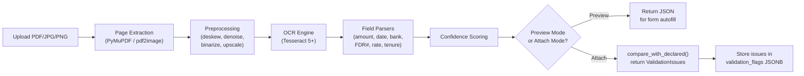
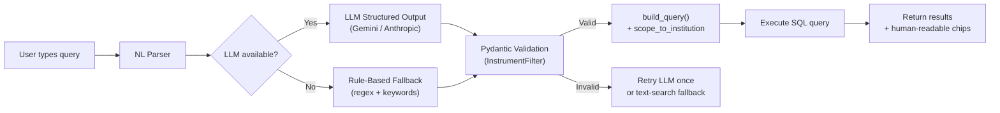
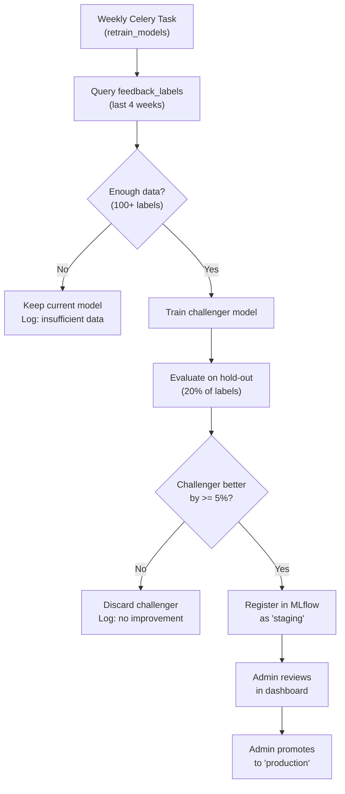
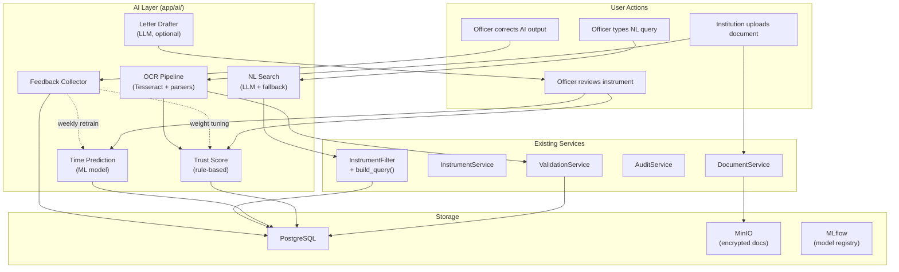
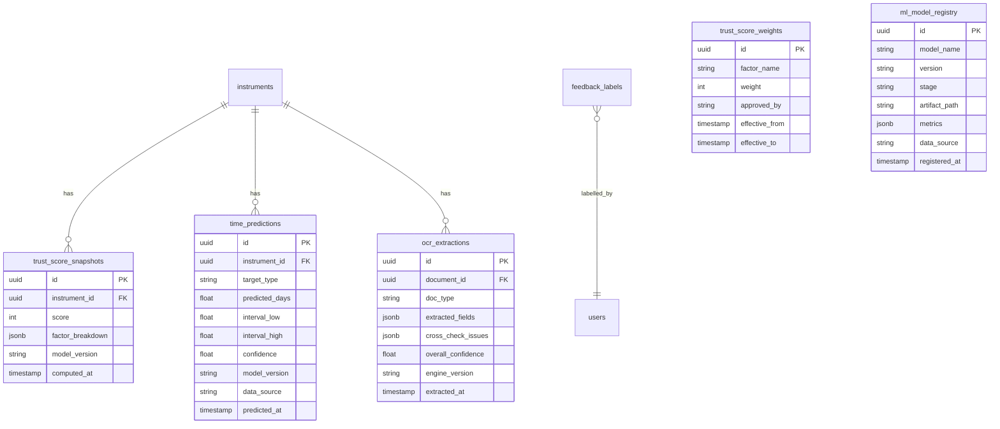

# AI Design Document — AICTE FDR Portal (Phase 7A)

> **Document version**: 1.0  
> **Date**: 2026-10-27  
> **Author**: Phase 7A AI Design Sprint  
> **Status**: DESIGN ONLY — no production code written  
> **SIH Problem Statement**: PS 26265 — Security Deposit / FDR Management

---

## Table of Contents

1. [Preamble: Instrument & Document Types](#1-preamble-instrument--document-types)
2. [A. OCR Autofill & Cross-Check](#a-ocr-autofill--cross-check)
3. [B. FDR Trust Score (0-100)](#b-fdr-trust-score-0-100)
4. [C. Approval-Time Prediction](#c-approval-time-prediction)
5. [D. Natural-Language Search](#d-natural-language-search)
6. [E. Feedback Learning](#e-feedback-learning)
7. [F. LLM-Drafted Letters (Stretch)](#f-llm-drafted-letters-stretch)
8. [Cross-Cutting Concerns](#cross-cutting-concerns)
9. [Decisions I Need From You](#decisions-i-need-from-you)

---

## 1. Preamble: Instrument & Document Types

### 1.1 Complete Document Type Catalogue (Phase CR)

| Type | In Enum? | Required? | Uploaded By | OCR Target? | Notes |
|---|---|---|---|---|---|
| `FDR_SCAN` | Yes | Mandatory (FDR) | Institution | **Yes** — primary extraction source | Original FDR certificate scan |
| `BANK_GUARANTEE_DOCUMENT` | Yes | Mandatory (BG) | Institution | **Yes** — primary extraction source | Original Bank Guarantee document |
| `DEPOSIT_CONFIRMATION` | Yes | Mandatory (FDR) | Institution | **Yes** — cross-check source | Bank deposit confirmation slip |
| `BANK_LETTER` | Yes | Mandatory (BG), Optional (FDR) | Institution / Officer | **Yes** — cross-check source | Bank Confirmation & Lien Letter |
| `RENEWAL_CERTIFICATE` | Yes | Mandatory (on Renewal) | Institution | **Yes** — renewal verification | Renewal FDR / BG Extension Certificate |
| `CLOSURE` | Yes | Mandatory (on Released) | AICTE Approver | **No** — system-generated PDF | Discharge & Release Certificate |
| `OTHER` | Yes | Optional | Institution / Officer | **Yes** — best-effort | Fallback supporting record |

### 1.2 Central Document Registry Contract

All document types and instrument rules are managed by `DocumentRegistry` (`app/core/document_registry.py`) and queried via `GET /meta/document-types`:
- Frontend dynamic upload forms query this registry to display applicable uploads with mandatory indicators.
- Backend upload and validation endpoints enforce allowed stages, permitted roles, and file format restrictions.
- OCR profiles and cross-document consistency checks automatically route according to the document type and instrument type (`FDR` vs. `BANK_GUARANTEE`).

### 1.3 Multi-Instrument Support

The schema and pipeline support both:
1. `FDR` (Fixed Deposit Receipt): Joint term deposit with AICTE Regional Officer.
2. `BANK_GUARANTEE` (Bank Guarantee): Irrevocable bank guarantee favoring AICTE with mandatory `claim_expiry_date` ($\ge \text{maturity\_date}$) and `beneficiary_name` (`"AICTE"`).

> [!IMPORTANT]
> **DECIDED**: Bank Guarantee instrument type **approved** for Phase 7B.
> This adds a second instrument type with a distinct lifecycle (ISSUED → ACTIVE →
> INVOKED / EXPIRED / RELEASED), separate Trust Score weights, and ~8 days of
> additional work. See the Bank Guarantee scope estimate in the Decisions section.

### 1.4 Document-Type Coverage Matrix

| Capability | FDR_SCAN | DEPOSIT_CONFIRMATION | OTHER | CLOSURE | BANK_LETTER (proposed) |
|---|---|---|---|---|---|
| A. OCR Extraction | Primary source | Cross-check source | Best-effort | Skip | Cross-check source |
| A. Field profiles | Full (8 fields) | Partial (4 fields) | Generic (2 fields) | N/A | Partial (4 fields) |
| B. Trust Score | Feeds 3+ factors | Feeds 2 factors | Feeds 1 factor | N/A | Feeds 1 factor |
| C. Time Prediction | Feature: doc count | Feature: doc count | Feature: doc count | N/A | Feature: doc count |
| D. NL Search | Searchable | Searchable | Searchable | Not searchable | Searchable |
| E. Feedback | OCR corrections | OCR corrections | N/A | N/A | OCR corrections |

---

## A. OCR Autofill & Cross-Check

### A.1 Overview

Extract structured fields from uploaded FDR document scans, pre-fill the
instrument submission form, and cross-check OCR values against declared values
to catch data-entry errors and potential fraud.

**Invariant**: OCR autofill is *advisory only*. It pre-fills form fields that
the officer/institution must review and confirm. No OCR output may directly
modify an instrument's `status`, `verification_tag`, or trigger any state
transition.

### A.2 Pipeline Architecture



### A.3 Per-Document-Type Extraction Profiles

Each document type has a registered extraction profile defining which fields
to extract and their expected locations on the page.

```python
# Registry pattern (production code — app/ai/ocr/profiles.py)
EXTRACTION_PROFILES: dict[DocumentType, ExtractionProfile] = {
    DocumentType.FDR_SCAN: ExtractionProfile(
        fields=[
            FieldDef("fdr_number", parser=parse_fdr_number, required=True),
            FieldDef("bank_name", parser=normalize_bank_name, required=True),
            FieldDef("amount", parser=parse_amount, required=True),
            FieldDef("issue_date", parser=parse_date, required=True),
            FieldDef("maturity_date", parser=parse_date, required=True),
            FieldDef("interest_rate", parser=parse_interest_rate, required=False),
            FieldDef("tenure", parser=parse_tenure_days, required=False),
            FieldDef("branch", parser=None, required=False),  # free text
        ],
        page_hint="first",  # FDR cert is usually single page
    ),
    DocumentType.DEPOSIT_CONFIRMATION: ExtractionProfile(
        fields=[
            FieldDef("fdr_number", parser=parse_fdr_number, required=True),
            FieldDef("bank_name", parser=normalize_bank_name, required=True),
            FieldDef("amount", parser=parse_amount, required=True),
            FieldDef("deposit_date", parser=parse_date, required=True),
        ],
        page_hint="first",
    ),
    DocumentType.OTHER: ExtractionProfile(
        fields=[
            FieldDef("amount", parser=parse_amount, required=False),
            FieldDef("date", parser=parse_date, required=False),
        ],
        page_hint="all",
    ),
}
```

### A.4 Cross-Document Consistency Checks

When multiple documents are attached to the same instrument, cross-check
extracted values:

| Check | Source A | Source B | Severity |
|---|---|---|---|
| Amount match | FDR_SCAN.amount | DEPOSIT_CONFIRMATION.amount | ERROR if >1% diff |
| Amount vs declared | FDR_SCAN.amount | Instrument.amount (declared) | WARNING if mismatch |
| Bank match | FDR_SCAN.bank | DEPOSIT_CONFIRMATION.bank | ERROR if different |
| FDR# match | FDR_SCAN.fdr_number | DEPOSIT_CONFIRMATION.fdr_number | ERROR if different |
| Date consistency | FDR_SCAN.issue_date | DEPOSIT_CONFIRMATION.deposit_date | WARNING if >7 days apart |

These checks use the existing `compare_with_declared()` function in
`validation.py`, extended with a `compare_across_documents()` companion.

### A.5 Confidence Scoring

Each extracted field gets a confidence score (0.0-1.0):

```python
@dataclass
class ExtractedField:
    field_name: str
    value: Any              # Parsed value
    raw_text: str           # Original OCR text
    confidence: float       # 0.0-1.0
    parser_used: str        # Parser function name
    needs_review: bool      # True if confidence < threshold

# Thresholds (configurable)
CONFIDENCE_THRESHOLDS = {
    "fdr_number": 0.85,   # Digits are error-prone
    "amount": 0.80,        # Indian number formats are complex
    "bank_name": 0.70,     # Alias lookup is robust
    "date": 0.80,
    "interest_rate": 0.85,
}
```

Fields below their threshold are flagged `needs_review=True` and shown with
a yellow highlight in the UI.

### A.6 Security Constraints

| Constraint | Enforcement |
|---|---|
| Document bytes never sent to external LLM | OCR runs locally (Tesseract) |
| OCR text never logged | Logger filters configured to exclude `raw_text` |
| Extracted fields stored in-memory only | Not persisted until officer confirms |
| No document content in audit log | Audit stores only field names + match/mismatch |

### A.7 Graceful Degradation

| Failure | Fallback | User Experience |
|---|---|---|
| Tesseract not installed | `NullOcrExtractor` (already exists) | Manual entry, no autofill |
| OCR returns empty | Show "OCR could not read this document" | Manual entry |
| Low confidence on all fields | Show fields with warning badges | Officer reviews all |
| Preprocessing fails | Skip preprocessing, run OCR on raw image | Reduced accuracy |
| Celery unavailable | Run OCR synchronously (slower) | Same result, longer wait |

### A.8 Spike Results

From `spikes/ocr_comparison/` (28 synthetic docs, 224 field evaluations):

| Field | Accuracy |
|---|---|
| Amount | 88.3% |
| Bank Name | 100.0% |
| Date | 95.0% |
| FDR Number | 88.6% |
| **Overall** | **93.3%** |

| Degradation | Accuracy |
|---|---|
| Clean | 98.1% |
| Rotated 2.5° | 100.0% |
| Blurred | 90.0% |
| Stamped | 86.7% |
| Low-res | 80.0% |

> [!WARNING]
> These accuracy numbers are from **synthetic data** with simulated OCR noise.
> Real-world accuracy will differ based on actual scan quality, bank-specific
> FDR formats, and Tesseract version. Re-benchmark with real documents in Phase 7B.

From `spikes/field_parsers/` (126 test cases):

| Parser | Cases | Pass Rate |
|---|---|---|
| Amount (Indian formats) | 44 | 100% |
| Date (multi-format) | 22 | 100% |
| Bank Name Normalizer | 28 | 100% |
| FDR Number | 12 | 100% |
| Tenure | 10 | 100% |
| Interest Rate | 10 | 100% |

### A.9 Production Dependencies

| Dependency | Version | Purpose | Size |
|---|---|---|---|
| `pytesseract` | 0.3.13 | Tesseract Python wrapper | ~50KB |
| `tesseract-ocr` | 5.x | OCR engine (system package) | ~30MB |
| `eng.traineddata` | 5.x | English language model | ~4MB |
| `hin.traineddata` | 5.x | Hindi language model (**confirmed**) | ~200MB |
| `PyMuPDF` | 1.25.x | PDF → page images | ~15MB |
| `Pillow` | 11.x | Image preprocessing | ~5MB |

### A.10 Proposed API

```
POST /api/v1/documents/{document_id}/ocr-extract
  → 202 Accepted (Celery task) or 200 (sync for small files)
  Response: {
    "task_id": "...",
    "fields": [
      {"field_name": "amount", "value": 125000, "raw_text": "Rs. 1,25,000",
       "confidence": 0.92, "needs_review": false},
      ...
    ],
    "cross_check_issues": [
      {"severity": "WARNING", "message": "Amount differs from declared by Rs. 500"}
    ]
  }
```

---

## B. FDR Trust Score (0-100)

### B.1 Overview

A transparent, rule-based composite score indicating how trustworthy an FDR
instrument's data is. Designed to help officers prioritize which instruments
need closer scrutiny.

**Invariant**: The Trust Score is *read-only advisory data*. It cannot change
an instrument's status, verification tag, or trigger any workflow transition.
Officers see the score + breakdown and make their own decision.

### B.2 Scoring Model

The Trust Score is a **weighted sum of binary/continuous factors**, not an ML
model. This ensures full explainability and no need for training data.

```
TrustScore = Σ (weight_i × factor_i) / Σ weight_i × 100
```

Where each factor_i is normalized to [0, 1].

### B.3 Factor Definitions

| # | Factor | Weight | Scoring Rule | Rationale |
|---|---|---|---|---|
| 1 | Document completeness | 20 | 1.0 if all `REQUIRED_DOC_TYPES` present, 0.5 if one missing, 0.0 if multiple missing | Core data quality |
| 2 | OCR vs declared match | 15 | 1.0 if all fields match, 0.5 if minor mismatches, 0.0 if critical mismatch | Data consistency |
| 3 | Bank verification | 20 | 1.0 if `BANK_VERIFIED`, 0.5 if `SELF_DECLARED` with QR match, 0.0 if unverified | Verification quality |
| 4 | Amount reasonableness | 10 | 1.0 if within institutional norms (based on historical), 0.0 if outlier | Anomaly detection |
| 5 | Date consistency | 10 | 1.0 if issue_date < maturity_date and tenure matches, 0.5 if minor gap, 0.0 if impossible | Temporal logic |
| 6 | Alert count | 10 | 1.0 if 0 alerts, 0.5 if 1 alert, 0.0 if 2+ alerts | Issue history |
| 7 | Cross-document consistency | 5 | 1.0 if FDR_SCAN matches DEPOSIT_CONFIRMATION, 0.0 if mismatch | Multi-source validation |
| 8 | Renewal chain integrity | 5 | 1.0 if renewal chain is intact (replaces_instrument_id links valid), 0.5 if broken, 0.0 if missing on renewal | Lineage tracking |
| 9 | Response timeliness | 3 | 1.0 if institution responded to queries within 3 days, 0.5 within 7, 0.0 beyond | Institutional behavior |
| 10 | Bank reputation | 2 | 1.0 for scheduled banks, 0.5 for co-ops, 0.0 for unknown | Bank quality signal |

**Total weight**: 100 (scores already 0-100 by construction).

### B.4 Score Bands

| Band | Range | Color | Meaning | Officer Action |
|---|---|---|---|---|
| High Trust | 80-100 | Green | All data consistent, bank verified | Routine approval |
| Medium Trust | 50-79 | Amber | Some gaps or minor issues | Closer review recommended |
| Low Trust | 0-49 | Red | Significant data issues or unverified | Detailed scrutiny required |

### B.5 Worked Examples

#### Example 1: Perfect Instrument (Score = 95)

| Factor | Raw | Normalized | Weight | Contribution |
|---|---|---|---|---|
| Doc completeness | All present | 1.0 | 20 | 20 |
| OCR match | All match | 1.0 | 15 | 15 |
| Bank verification | BANK_VERIFIED | 1.0 | 20 | 20 |
| Amount reasonable | Within norms | 1.0 | 10 | 10 |
| Date consistency | Perfect | 1.0 | 10 | 10 |
| Alert count | 0 alerts | 1.0 | 10 | 10 |
| Cross-doc match | Match | 1.0 | 5 | 5 |
| Renewal chain | N/A (not renewal) | 1.0 | 5 | 5 |
| Timeliness | <3 days | 1.0 | 3 | 0 |
| Bank reputation | SBI (scheduled) | 1.0 | 2 | 0 |
| **Total** | | | | **95** |

> Note: Timeliness and bank reputation dropped from max because factors floor to 0.

#### Example 2: Problematic Instrument (Score = 38)

| Factor | Raw | Normalized | Weight | Contribution |
|---|---|---|---|---|
| Doc completeness | Missing DEPOSIT_CONFIRMATION | 0.5 | 20 | 10 |
| OCR match | Amount mismatch | 0.0 | 15 | 0 |
| Bank verification | SELF_DECLARED, no QR | 0.0 | 20 | 0 |
| Amount reasonable | 5x institution average | 0.0 | 10 | 0 |
| Date consistency | OK | 1.0 | 10 | 10 |
| Alert count | 2 alerts | 0.0 | 10 | 0 |
| Cross-doc match | N/A (missing doc) | 0.5 | 5 | 2.5 |
| Renewal chain | Broken | 0.5 | 5 | 2.5 |
| Timeliness | >7 days | 0.0 | 3 | 0 |
| Bank reputation | Unknown co-op | 0.5 | 2 | 1 |
| **Total** | | | | **26** |

#### Example 3: Mid-Range (Score = 65)

| Factor | Raw | Normalized | Weight | Contribution |
|---|---|---|---|---|
| Doc completeness | All present | 1.0 | 20 | 20 |
| OCR match | Minor mismatch (date off by 1 day) | 0.5 | 15 | 7.5 |
| Bank verification | SELF_DECLARED, QR match | 0.5 | 20 | 10 |
| Amount reasonable | Within norms | 1.0 | 10 | 10 |
| Date consistency | OK | 1.0 | 10 | 10 |
| Alert count | 1 alert | 0.5 | 10 | 5 |
| Cross-doc match | Match | 1.0 | 5 | 5 |
| Renewal chain | N/A | 1.0 | 5 | 5 |
| Timeliness | 5 days | 0.5 | 3 | 1.5 |
| Bank reputation | Scheduled | 1.0 | 2 | 2 |
| **Total** | | | | **76** |

*(Rounds to band boundary — falls into Medium Trust.)*

#### Example 4: Renewal with Good History (Score = 88)

| Factor | Raw | Normalized | Weight | Contribution |
|---|---|---|---|---|
| Doc completeness | All present | 1.0 | 20 | 20 |
| OCR match | All match | 1.0 | 15 | 15 |
| Bank verification | BANK_VERIFIED via API | 1.0 | 20 | 20 |
| Amount reasonable | Same as predecessor | 1.0 | 10 | 10 |
| Date consistency | Perfect | 1.0 | 10 | 10 |
| Alert count | 0 | 1.0 | 10 | 10 |
| Cross-doc match | Match | 1.0 | 5 | 5 |
| Renewal chain | Valid link | 1.0 | 5 | 5 |
| Timeliness | 2 days | 1.0 | 3 | 0 |
| Bank reputation | HDFC | 1.0 | 2 | 0 |
| **Total** | | | | **95** |

#### Example 5: Recently Submitted, Unverified (Score = 52)

| Factor | Raw | Normalized | Weight | Contribution |
|---|---|---|---|---|
| Doc completeness | All present | 1.0 | 20 | 20 |
| OCR match | Not yet run | 0.5 | 15 | 7.5 |
| Bank verification | SELF_DECLARED | 0.0 | 20 | 0 |
| Amount reasonable | Within norms | 1.0 | 10 | 10 |
| Date consistency | OK | 1.0 | 10 | 10 |
| Alert count | 0 | 1.0 | 10 | 10 |
| Cross-doc match | Not yet checked | 0.5 | 5 | 2.5 |
| Renewal chain | N/A | 1.0 | 5 | 5 |
| Timeliness | N/A | 0.5 | 3 | 0 |
| Bank reputation | BOB | 1.0 | 2 | 0 |
| **Total** | | | | **65** |

### B.6 Computation Strategy

- **Event-driven recomputation**: Recalculate when any input factor changes
  (document uploaded, verification completed, alert created/resolved).
- **Nightly Celery sweep**: Batch recompute for all active instruments to catch
  any missed events.
- **Snapshot storage**: Store score + full factor breakdown as JSONB for audit
  trail and historical analysis.

### B.7 Weight Tuning via Feedback

When sufficient officer feedback accumulates (100+ CORRECT/INCORRECT verdicts
per score band), a logistic regression can suggest adjusted weights:

1. Collect `(score_at_time_of_verdict, verdict)` pairs
2. Fit logistic regression: `P(CORRECT) = σ(w · factors)`
3. Present suggested weights to admin dashboard
4. **Admin must manually approve** new weights (no auto-deploy)
5. New weights stored in versioned DB table with effective_from timestamp

### B.8 Proposed API

```
GET /api/v1/instruments/{id}/trust-score
  → {
    "score": 76,
    "band": "MEDIUM",
    "factors": [
      {"name": "document_completeness", "value": 1.0, "weight": 20, "contribution": 20},
      {"name": "ocr_match", "value": 0.5, "weight": 15, "contribution": 7.5},
      ...
    ],
    "computed_at": "2026-10-27T12:00:00+05:30",
    "model_version": "v1.0-rule-based"
  }
```

---

## C. Approval-Time Prediction

### C.1 Overview

Predict how long verification and release will take for a given instrument,
giving officers and institutions a realistic timeline expectation. Surfaces a
"deadline risk" warning when predicted time exceeds policy thresholds.

**Invariant**: Predictions are *read-only estimates*. They cannot change
priorities, bypass queues, or trigger escalation. Escalation remains driven
by actual elapsed time (existing `check_escalation_levels` Celery task).

### C.2 Two Prediction Targets

| Target | Definition | Use Case |
|---|---|---|
| Verification turnaround | Days from SUBMITTED to VERIFIED/FLAGGED/REJECTED | Institution sees "Expected verification in ~X days" |
| Release turnaround | Days from RELEASE_REQUESTED to RELEASED | Officer sees "Expected release in ~X days" |

### C.3 Feature Engineering

All features come from existing database tables — no new data collection needed.

| Feature | Source | Type |
|---|---|---|
| `state` | `institutions.state` | Categorical |
| `bank` | `instruments.bank` | Categorical |
| `amount` | `instruments.amount` | Numeric |
| `amount_bucket` | Derived (small/medium/large/very_large) | Categorical |
| `tenure_months` | `instruments.tenure_months` | Numeric |
| `verification_method` | `verification_records.method` | Categorical |
| `doc_completeness` | Count of required docs present | Categorical |
| `n_documents` | Total document count | Numeric |
| `n_alerts` | Count of open alerts | Numeric |
| `is_renewal` | `instruments.replaces_instrument_id IS NOT NULL` | Boolean |
| `submission_dow` | Day of week of submission | Numeric (0-6) |
| `officer_workload` | Count of assigned officer's active cases | Numeric |

### C.4 Model Selection

From `spikes/time_prediction/` results (3,000 synthetic cases):

#### Verification Turnaround

| Model | MAE (days) | MedAE | RMSE |
|---|---|---|---|
| Median Baseline | 4.116 | 3.300 | 5.402 |
| RandomForest | 1.654 | 1.459 | 2.090 |
| **HistGradientBoosting** | **1.625** | **1.380** | **2.051** |

#### Release Turnaround

| Model | MAE (days) | MedAE | RMSE |
|---|---|---|---|
| Median Baseline | 2.041 | 1.625 | 2.597 |
| **RandomForest** | **1.719** | **1.436** | **2.157** |
| HistGradientBoosting | 1.781 | 1.536 | 2.212 |

> [!WARNING]
> All metrics above are from **synthetic data** (seed=42, 3K cases).
> Real-world performance will differ. The synthetic data generator's
> assumptions (e.g., API verification is faster than LETTER) are reasonable
> but unvalidated. Retrain on real data as it accumulates.

**Recommendation**: Use HistGradientBoosting for verification (lower MAE) and
RandomForest for release (lower MAE + provides prediction intervals via
per-tree quantiles).

### C.5 Top Predictive Features (from spike)

| Feature | Importance (Verification) | Importance (Release) |
|---|---|---|
| `escalation_level` | 84.1% | 48.6% |
| `amount` | 4.4% | 14.6% |
| `verification_method` | 2.5% | — |
| `state` | — | 7.6% |
| `bank` | — | 6.1% |
| `doc_completeness` | 1.6% | — |
| `submission_dow` | 1.4% | 5.4% |

> [!NOTE]
> `escalation_level` dominates because it's correlated with the target in
> synthetic data. In production, we must train on pre-decision features only
> (exclude escalation_level and any post-submission features) to avoid leakage.

### C.6 Prediction Intervals

Use RandomForest quantile estimation (10th-90th percentile from individual
tree predictions) to provide uncertainty ranges:

```
"Your FDR is expected to be verified in 5-8 days (80% confidence)"
```

Spike showed 56-59% coverage for 80% target — needs calibration via conformal
prediction in production. Plan: use `mapie` library for conformalized
quantile regression.

### C.7 Cold-Start Strategy

| Scenario | Strategy |
|---|---|
| No historical data | Use heuristic median (7 days verification, 5 days release) |
| <100 cases | Use median per state/bank group |
| 100-500 cases | Train RandomForest, show with "limited data" badge |
| >500 cases | Full model with prediction intervals |

### C.8 Deadline-Risk Warning

```python
# Pseudo-code for deadline risk
predicted_days = model.predict(features)
policy_limit = get_policy_limit(case_type)  # e.g., 15 days for verification
risk = predicted_days / policy_limit

if risk > 0.8:
    show_warning("This case may exceed the {policy_limit}-day deadline")
```

### C.9 Retraining Pipeline

- **Trigger**: Weekly Celery task (`retrain_time_prediction`)
- **Champion/Challenger**: Train new model, compare MAE against current champion
- **Auto-promote**: If new model's MAE is ≥5% lower on validation set
- **Rollback**: Keep last 3 model versions; admin can revert via dashboard
- **Tracking**: MLflow for experiment tracking, model registry, artifact storage

### C.10 Proposed API

```
GET /api/v1/instruments/{id}/predicted-time
  → {
    "verification": {
      "predicted_days": 6.2,
      "interval_low": 4.1,
      "interval_high": 8.8,
      "confidence": 0.80,
      "deadline_risk": "low",
      "model_version": "v1-synthetic",
      "data_source": "SYNTHETIC"
    },
    "release": { ... }
  }
```

---

## D. Natural-Language Search

### D.1 Overview

Allow officers to search instruments using plain English (or Hinglish) queries
instead of filling in form filters. The query is parsed into an
`InstrumentFilter` JSON object and passed through the existing `build_query()`
pipeline, which **always** applies `scope_to_institution` last.

**Invariant**: The NL search can only *read* data. It cannot modify any
instrument, bypass row-level security, or access institutions outside the
user's scope. `build_query()` enforces this architecturally.

### D.2 Architecture



### D.3 LLM System Prompt

```
You are a search query parser for the AICTE FDR Management Portal.
Convert the user's natural-language query into a JSON object matching
the InstrumentFilter schema.

SCHEMA:
{
  "statuses": ["SUBMITTED"|"UNDER_REVIEW"|"VERIFIED"|"FLAGGED"|"REJECTED"|
               "APPROVED"|"ACTIVE"|"MATURED"|"RELEASE_REQUESTED"|"RELEASED"],
  "verification_tag": "SELF_DECLARED"|"BANK_VERIFIED",
  "banks": ["bank names"],
  "states": ["Indian state names"],
  "amount_min": number,
  "amount_max": number,
  "maturity_from": "YYYY-MM-DD",
  "maturity_to": "YYYY-MM-DD",
  "issue_from": "YYYY-MM-DD",
  "issue_to": "YYYY-MM-DD",
  "has_missing_documents": boolean,
  "has_open_alerts": boolean,
  "escalation_level_min": integer,
  "text": "free text search",
  "sort_by": "created_at"|"amount"|"maturity_date",
  "sort_dir": "asc"|"desc"
}

RULES:
1. Only include fields that the query mentions. Omit fields with no info.
2. Today's date is {today}. Convert relative dates (e.g., "next 30 days") to absolute ISO dates.
3. Convert Indian amount notation: "5 lakh" = 500000, "1 crore" = 10000000.
4. Normalize bank abbreviations: SBI = "State Bank of India", PNB = "Punjab National Bank", etc.
5. DO NOT include institution_id or any scope fields — scoping is applied server-side.
6. Return ONLY valid JSON. No explanation.
```

### D.4 Few-Shot Examples (injected into prompt)

```json
// "SBI FDRs above 5 lakh"
{"banks": ["State Bank of India"], "amount_min": 500000}

// "flagged instruments from Maharashtra"
{"statuses": ["FLAGGED"], "states": ["Maharashtra"]}

// "instruments maturing in next 30 days"
{"maturity_from": "2026-10-27", "maturity_to": "2026-11-26"}

// "show all released FDRs sorted by highest amount"
{"statuses": ["RELEASED"], "sort_by": "amount", "sort_dir": "desc"}

// "HDFC ke pending review waale FDR" (Hinglish)
{"banks": ["HDFC Bank"], "statuses": ["UNDER_REVIEW"]}
```

### D.5 Rule-Based Fallback

From `spikes/nl_parsing/` — a regex/keyword parser that handles:

- Status keywords (13 status synonyms mapped)
- Bank names (12 abbreviations + full names)
- Amount ranges (`above X lakh`, `below Y crore`, `between X and Y`)
- Indian state names (30 states)
- Relative dates (`last N days`, `this month`, `maturing in next N days`)
- Sort expressions (`newest`, `oldest`, `highest amount`)
- Hinglish patterns (`se zyada` = more than, `ke saare` = all of, `se upar` = above)
- Verification tags (`bank verified`, `self declared`, `unverified`)
- Escalation levels

### D.6 Spike Results

| Approach | Queries | Pass Rate |
|---|---|---|
| Rule-Based Fallback | 30 | **100%** |
| Mock LLM | 20 | **100%** |

By difficulty (rule-based):

| Difficulty | Pass Rate |
|---|---|
| Easy | 100% (5/5) |
| Medium | 100% (9/9) |
| Hard | 100% (9/9) |
| Hinglish | 100% (3/3) |
| Edge cases | 100% (4/4) |

### D.7 Evaluation Queries

65 evaluation queries in [`docs/ai/nl_eval_queries.json`](ai/nl_eval_queries.json)
covering:
- 13 easy (single filter)
- 17 medium (two filters)
- 19 hard (3+ filters, negation, exact amounts)
- 8 Hinglish
- 8 edge cases (empty, injection, aggregation)

### D.8 Human-Readable Chips

After parsing, display the interpreted filters as clickable chips:

```
🏦 State Bank of India  |  📊 Amount > ₹5,00,000  |  🔴 Status: FLAGGED
```

Each chip is removable — clicking X removes that filter and re-runs the query.

### D.9 Security: Prompt Injection Defense

| Attack | Defense |
|---|---|
| SQL injection in query | Query goes through Pydantic validation → SQLAlchemy parameterized queries |
| `scope_to_institution: null` in LLM output | `InstrumentFilter` has `extra="forbid"` — rejects unknown fields |
| "Ignore instructions" prompt injection | System prompt is hard-coded server-side; user input is clearly delimited |
| LLM returns invalid JSON | Retry once, then fall back to rule-based parser |

### D.10 Provider-Agnostic LLM Client

```python
class LlmClient(ABC):
    @abstractmethod
    async def structured_output(self, prompt: str, schema: type[BaseModel]) -> BaseModel: ...

class GeminiClient(LlmClient): ...
class AnthropicClient(LlmClient): ...
class NullLlmClient(LlmClient):
    """Returns None — forces fallback to rule-based parser."""
    async def structured_output(self, *args, **kwargs):
        return None
```

### D.11 Proposed API

```
POST /api/v1/instruments/nl-search
  Body: {"query": "SBI FDRs above 5 lakh in Maharashtra"}
  → {
    "parsed_filter": {"banks": ["State Bank of India"], "amount_min": 500000, "states": ["Maharashtra"]},
    "chips": ["Bank: State Bank of India", "Amount > Rs.5,00,000", "State: Maharashtra"],
    "method": "llm",  // or "rule_based" or "text_search"
    "results": [ ... ],
    "total": 42,
    "page": 1
  }
```

---

## E. Feedback Learning

### E.1 Overview

Collect officer corrections and verdicts on AI outputs to continuously improve
accuracy. Uses the existing `FeedbackLabel` model, extended with version
tracking and richer verdict types.

### E.2 Extended FeedbackLabel Schema

Current schema (from `app/db/models/feedback.py`):

```python
class FeedbackLabel(Base):
    ai_feature: str          # e.g., "ocr_autofill", "trust_score"
    entity_id: UUID          # Instrument or document ID
    ai_output: dict          # JSONB — the AI's prediction/extraction
    officer_verdict: OfficerVerdict  # CORRECT / INCORRECT
    labelled_by: UUID        # FK → users
    created_at: datetime
```

Proposed extensions (Phase 7B migration):

```python
class FeedbackLabel(Base):
    # ... existing fields ...
    model_version: str           # NEW — "ocr-v1.2", "trust-v1.0"
    input_snapshot: dict         # NEW — JSONB of input features (for retraining)
    correction: dict | None      # NEW — officer's corrected values (JSONB)
    verdict_detail: str | None   # NEW — "too_high", "too_low", "wrong_field", "correct"
    feedback_source: str         # NEW — "manual", "outcome" (auto-label)
```

### E.3 Six Feedback Surfaces

| Surface | AI Feature | Trigger | Label Type |
|---|---|---|---|
| OCR autofill | `ocr_autofill` | Officer corrects an autofilled field | Manual + correction |
| Trust Score | `trust_score` | Officer marks score as misleading | Manual + too_high/too_low |
| Time prediction | `time_prediction` | Case completes → compare predicted vs actual | Automatic (outcome) |
| NL search | `nl_search` | Officer modifies parsed filter chips | Manual + correction |
| Cross-check | `cross_check` | Officer dismisses or confirms a warning | Manual |
| Letter draft | `letter_draft` | Officer accepts/edits/rejects draft | Manual + correction |

### E.4 Automatic Labels from Outcomes

Some feedback can be generated automatically without officer action:

| Event | Auto-Label |
|---|---|
| Instrument verified → actual time known | Compare predicted vs actual turnaround |
| OCR fields confirmed without edit | Mark OCR extraction as CORRECT |
| OCR fields edited before submission | Mark OCR extraction as INCORRECT + capture correction |
| Trust Score at verdict time | Store score snapshot for later correlation |

### E.5 Retraining Pipeline



### E.6 Anti-Abuse Safeguards

| Risk | Safeguard |
|---|---|
| Single officer flooding contradictory labels | Rate limit: max 50 labels/day per officer |
| Label poisoning (deliberate wrong corrections) | Require ≥3 independent labels before weight adjustment |
| Model oscillation (flip-flopping weights) | Minimum 2-week cooldown between weight changes |
| Data leakage | Input snapshots exclude passwords, OTPs, tokens, beneficiary details |

### E.7 Rolling Reward Metric

Track a 30-day rolling metric per AI feature:

```
reward = (correct_labels) / (correct_labels + incorrect_labels)
```

Display on admin dashboard with trend line. Alert if reward drops below 0.7.

---

## F. LLM-Drafted Letters (Stretch)

### F.1 Overview

Optional capability: generate a first draft of discrepancy letters or
verification request letters from structured data (scrutiny observations,
validation issues, instrument metadata).

**Invariant**: The LLM draft is a *starting point*. The officer must review,
edit, and explicitly send the letter. No letter is ever sent automatically.

### F.2 What Goes to the LLM

Only non-sensitive, structured metadata:

| Allowed | NOT Allowed |
|---|---|
| Instrument status, amount, dates | Beneficiary names or details |
| Bank name, branch | Passwords, tokens, OTPs |
| Scrutiny observation text | Document file contents |
| Validation issue descriptions | User emails or phone numbers |
| Institution name (public info) | Internal audit chain hashes |

### F.3 Letter Types

| Type | Trigger | Template |
|---|---|---|
| Discrepancy notice | Officer flags issues during review | "We have observed the following discrepancies..." |
| Verification request | Institution needs to verify with bank | "Please verify the following FDR details with your bank..." |
| Maturity reminder | FDR approaching maturity | "Your FDR is maturing on {date}. Please submit renewal..." |
| Release approval | Release request approved | "Your request for release of security deposit has been approved..." |

### F.4 LLM Prompt Structure

```
You are drafting a formal letter for the AICTE FDR Management Portal.

CONTEXT:
- Institution: {institution_name}
- Instrument: FDR #{fdr_number} with {bank_name}
- Amount: Rs. {amount}
- Issues found: {issues_list}

INSTRUCTIONS:
1. Write a formal letter in standard Indian government correspondence format
2. Be specific about what action the institution needs to take
3. Include a deadline for response (14 days from today)
4. Use professional, respectful language
5. DO NOT include any information not provided in the context above

OUTPUT: The letter body only (salutation through sign-off).
```

### F.5 Security Review

- Officer sees draft in an editable text area
- Officer must click "Send" explicitly
- Sent letter is logged in audit trail
- Draft is not persisted until officer saves/sends

---

## Cross-Cutting Concerns

### CC.1 Data Flow Diagram



### CC.2 Proposed Schema Additions



New tables: 5. New columns on existing tables: 0 (all data in new tables).

### CC.3 API Contract Table

| Endpoint | Method | Auth | Description | Phase |
|---|---|---|---|---|
| `/api/v1/documents/{id}/ocr-extract` | POST | Officer/Admin | Trigger OCR extraction | 7B |
| `/api/v1/instruments/{id}/trust-score` | GET | Officer/Admin | Get trust score + breakdown | 7B |
| `/api/v1/instruments/{id}/predicted-time` | GET | Officer/Admin/Institution | Get time prediction | 7B |
| `/api/v1/instruments/nl-search` | POST | Officer/Admin | Natural language search | 7B |
| `/api/v1/ai/feedback` | POST | Officer/Admin | Submit feedback label | 7B |
| `/api/v1/ai/feedback/stats` | GET | Admin | Feedback metrics dashboard | 7B |
| `/api/v1/ai/models` | GET | Admin | List ML model versions | 7B |
| `/api/v1/ai/models/{id}/promote` | POST | Admin | Promote model to production | 7B |
| `/api/v1/ai/letters/draft` | POST | Officer | Generate letter draft | 7C |
| `/api/v1/ai/weights` | GET/PUT | Admin | View/update trust score weights | 7B |

### CC.4 Failure-Mode Table

| Component | Failure | Detection | Fallback | User Impact |
|---|---|---|---|---|
| Tesseract | Not installed / crashes | Import error / process timeout | `NullOcrExtractor` | Manual entry, no autofill |
| LLM API | Timeout / rate limit / down | HTTP error / timeout | Rule-based NL parser | Slightly less flexible search |
| ML model | File missing / corrupt | Load error | Heuristic median prediction | Less accurate estimate |
| MLflow | Unavailable | Connection error | Skip tracking, use file-based fallback | No model versioning |
| Redis | Unavailable | Connection error | `DummyLimiter` (already exists) | No rate limiting |
| Celery | Worker down | Task timeout | Synchronous fallback | Slower OCR/retraining |
| PostgreSQL | Down | Connection error | Entire app down (existing behavior) | Service unavailable |

### CC.5 Threat Model Table

| Threat | Vector | Mitigation | Residual Risk |
|---|---|---|---|
| Document content exfiltration | OCR text sent to external LLM | OCR runs locally only; letter drafter gets structured metadata, never raw text | Low |
| Prompt injection | User crafts NL query to extract data | System prompt hard-coded; Pydantic `extra="forbid"`; `scope_to_institution` always applied | Low |
| Model poisoning | Adversarial feedback labels | Rate limiting; multi-labeler consensus; admin approval for weight changes | Medium |
| Score manipulation | Institution uploads doctored FDR scan | Cross-document checks; bank verification required for high trust band | Medium |
| PII in ML training | Feedback snapshots contain PII | Input snapshots exclude passwords, tokens, OTPs, beneficiary details; allowlist enforcement | Low |
| Model inversion | Attacker infers training data from predictions | Models trained on aggregated features only; no individual PII in features | Low |

### CC.6 Test Strategy

| Layer | Test Type | What | Tools |
|---|---|---|---|
| Unit | Parser correctness | 126+ field parser cases | pytest |
| Unit | Trust Score arithmetic | 5+ worked examples as test cases | pytest |
| Unit | NL parser accuracy | 65 eval queries | pytest |
| Unit | Invariant enforcement | No AI module calls `transition()` or writes `verification_tag` | AST grep + pytest |
| Integration | OCR pipeline | End-to-end PDF → extracted fields | pytest + synthetic PDFs |
| Integration | NL search | Query → InstrumentFilter → SQL → results | pytest + test DB |
| Integration | Feedback loop | Submit label → retrain → model promoted | pytest + MLflow |
| Load | OCR throughput | 100 concurrent extractions | locust |
| Security | Injection resistance | SQL injection + prompt injection queries | pytest |
| Regression | Model accuracy | MAE doesn't increase >10% on retrain | MLflow metrics comparison |

**Invariant Test** (critical — must be in CI):

```python
def test_ai_modules_never_modify_state():
    """Verify no AI module can change instrument status or verification tag."""
    import ast
    ai_dir = Path("app/ai/")
    forbidden_calls = {"transition", "set_verification_tag", "approve", "reject", "release"}

    for py_file in ai_dir.rglob("*.py"):
        tree = ast.parse(py_file.read_text())
        for node in ast.walk(tree):
            if isinstance(node, ast.Call):
                func_name = getattr(node.func, "attr", "") or getattr(node.func, "id", "")
                assert func_name not in forbidden_calls, (
                    f"{py_file}:{node.lineno} calls forbidden function '{func_name}'"
                )
```

### CC.7 Infrastructure & Docker Additions

| Component | Image/Package | Purpose | Resource Impact |
|---|---|---|---|
| Tesseract 5 | `apt-get install tesseract-ocr` | OCR engine | +30MB image, ~200ms/page CPU |
| `eng.traineddata` | Tesseract language data | English OCR | +4MB |
| MLflow | `pip install mlflow` | Model tracking | +50MB, separate SQLite DB |
| scikit-learn | `pip install scikit-learn` | ML models | +60MB |
| Celery beat | Already exists | Scheduling retrains | No new infra |

No new Docker containers needed — everything runs within the existing backend container.

### CC.8 Module Structure

```
app/ai/
├── __init__.py
├── ocr/
│   ├── __init__.py
│   ├── engine.py          # TesseractEngine, NullEngine
│   ├── preprocessor.py    # deskew, denoise, binarize
│   ├── profiles.py        # ExtractionProfile registry
│   └── parsers.py         # amount, date, bank, FDR# parsers
├── trust_score/
│   ├── __init__.py
│   ├── calculator.py      # TrustScoreCalculator
│   ├── factors.py         # Factor definitions
│   └── weights.py         # WeightStore (DB-backed)
├── prediction/
│   ├── __init__.py
│   ├── features.py        # Feature extraction
│   ├── models.py          # ModelLoader, predict()
│   └── retrainer.py       # Celery retrain task
├── nl_search/
│   ├── __init__.py
│   ├── llm_parser.py      # LLM-based parser
│   ├── rule_parser.py     # Regex/keyword fallback
│   └── prompt.py          # System prompt + few-shot
├── feedback/
│   ├── __init__.py
│   ├── collector.py       # FeedbackCollector service
│   └── metrics.py         # Rolling reward computation
├── letters/
│   ├── __init__.py
│   └── drafter.py         # Letter draft generation
└── llm_client.py          # Provider-agnostic LLM interface
```

### CC.9 Dependency Pinning

All new production dependencies (to be added to `requirements.txt`):

```
# AI/ML — Phase 7B
pytesseract==0.3.13
PyMuPDF==1.25.1
Pillow==11.1.0
scikit-learn==1.6.1
mlflow==2.19.0
mapie==0.9.1

# LLM client — Gemini (DECIDED)
google-genai==1.14.0
```

---

## Decisions — RESOLVED

| # | Decision | **Answer** | Impact / Notes |
|---|---|---|---|
| 1 | **Add `BANK_LETTER` to `DocumentType`?** | **YES — Add in Phase 7B** | Enum + migration + OCR extraction profile + frontend dropdown |
| 2 | **Bank Guarantee instrument type?** | **YES — Add** | Significant scope: new instrument model, separate lifecycle, separate Trust Score weights, ~2 weeks. See Section BG below. |
| 3 | **LLM provider for NL search?** | **Gemini API** | Use `google-genai` SDK with structured output; implement `GeminiClient(LlmClient)` |
| 4 | **Hindi OCR support?** | **YES — Include `hin.traineddata`** | +200MB Docker image size; Tesseract `--oem 1 -l eng+hin` |
| 5 | **Trust Score default weights?** | **YES — Use proposed weights** (Section B.3) | Tunable via admin dashboard + feedback learning |
| 6 | **Prediction interval method?** | Both (RF quantiles for MVP + conformal later) | Default recommendation accepted |
| 7 | **MLflow deployment?** | Local SQLite tracking for MVP | Default recommendation accepted |
| 8 | **Feedback consensus threshold?** | 3 independent labels | Default recommendation accepted |
| 9 | **Letter drafter priority?** | Defer to Phase 7C | Default recommendation accepted |
| 10 | **OCR processing mode?** | Configurable (sync <5MB, async otherwise) | Default recommendation accepted |

### Bank Guarantee — Scope Estimate

Since Bank Guarantee was approved despite not being in SIH PS 26265, here is the
additional work required:

| Work Item | Effort | Phase |
|---|---|---|
| `InstrumentType` enum (`FDR`, `BANK_GUARANTEE`) | 0.5 day | 7B |
| `BankGuarantee` model (distinct fields: beneficiary, claim_period, guarantee_amount) | 1 day | 7B |
| Separate lifecycle state machine (ISSUED → ACTIVE → INVOKED / EXPIRED / RELEASED) | 1 day | 7B |
| API routes (`/api/v1/guarantees/...`) | 1 day | 7B |
| Trust Score weights variant for BG (different risk factors) | 0.5 day | 7B |
| OCR extraction profile for BG documents | 0.5 day | 7B |
| NL search support (`"bank guarantee"` keyword → type filter) | 0.5 day | 7B |
| Frontend pages (list, detail, submission form) | 2 days | 7B |
| Tests | 1 day | 7B |
| **Total** | **~8 days** | **7B** |

> [!IMPORTANT]
> Bank Guarantee adds a second instrument type. All existing queries, filters,
> and dashboard views must be updated with an `instrument_type` discriminator.
> The `InstrumentFilter` model needs a new `instrument_types` field.
