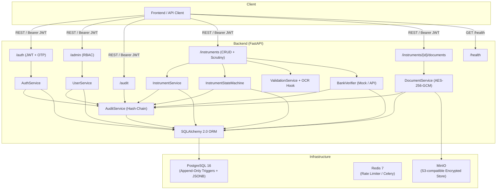
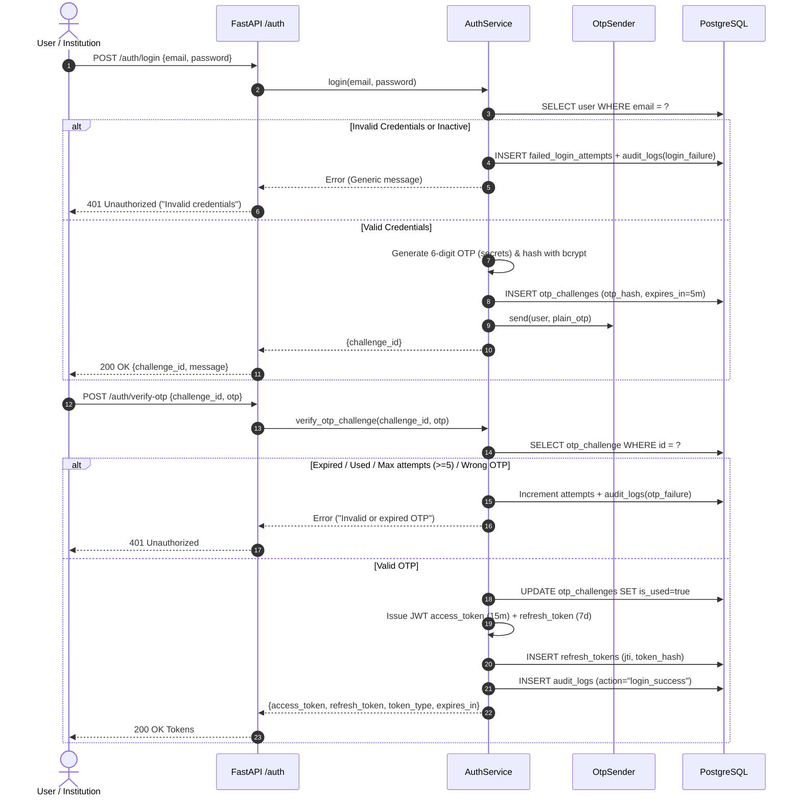
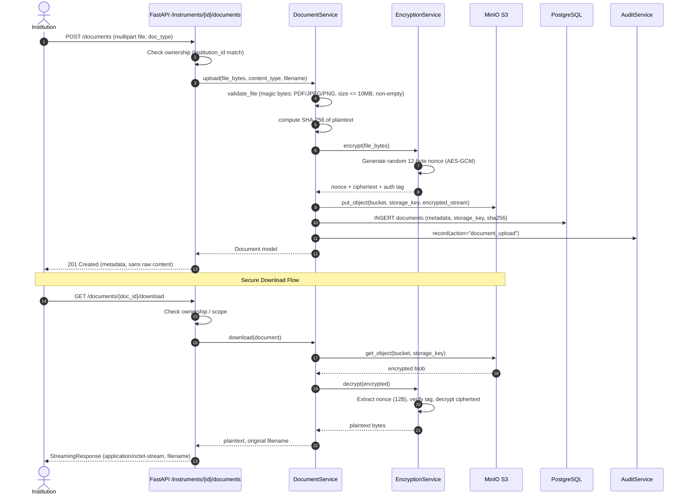
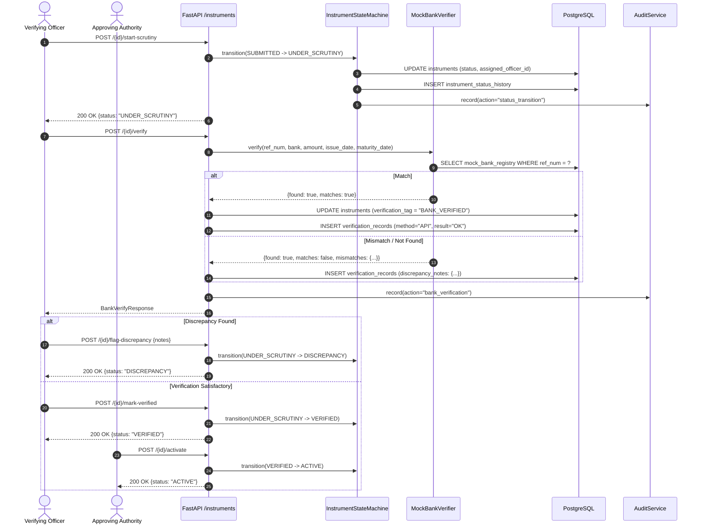
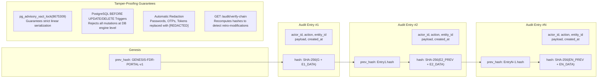
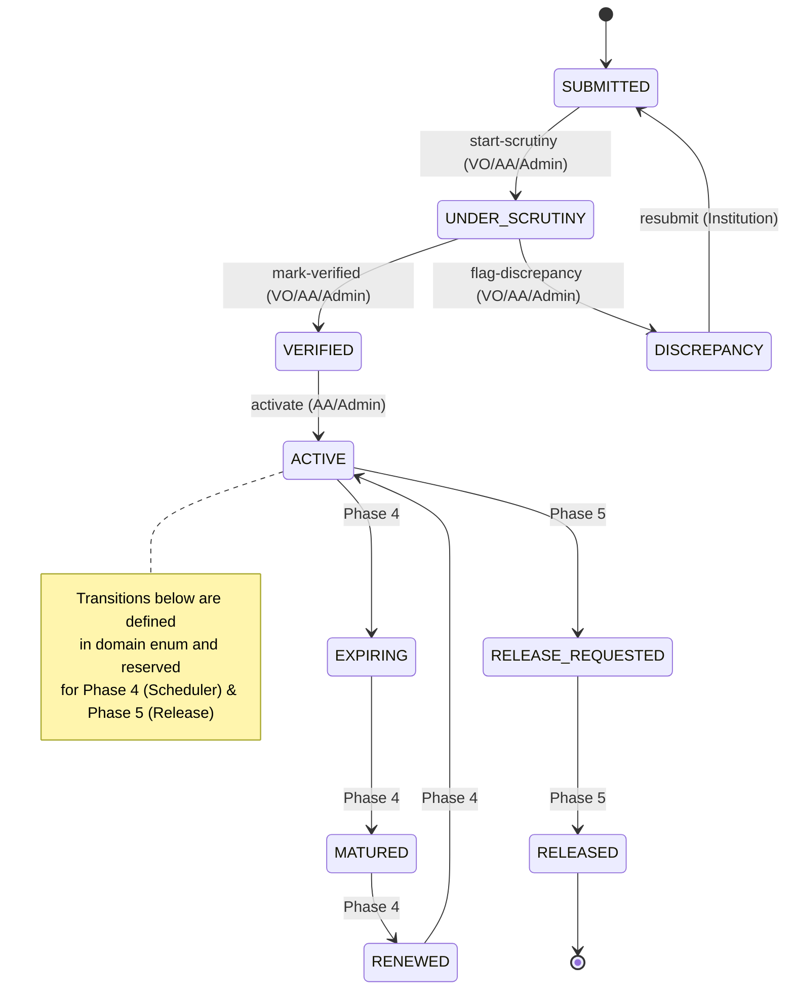
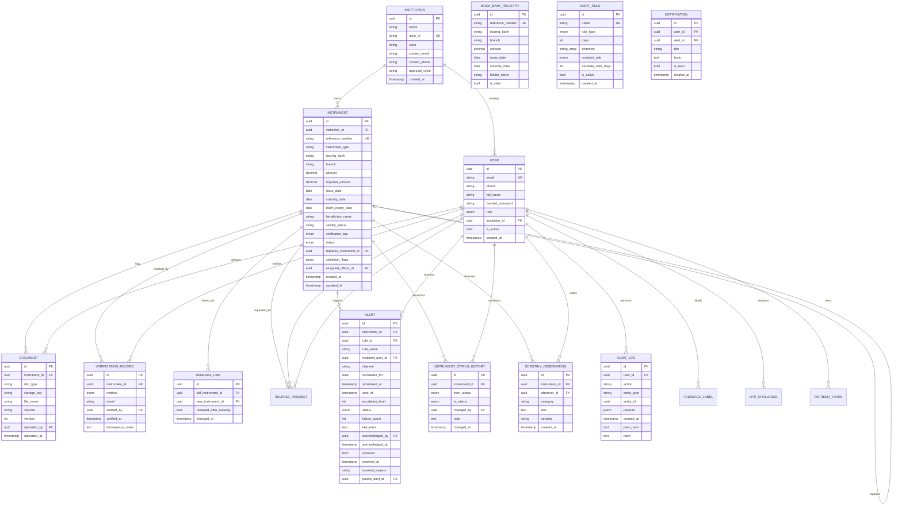
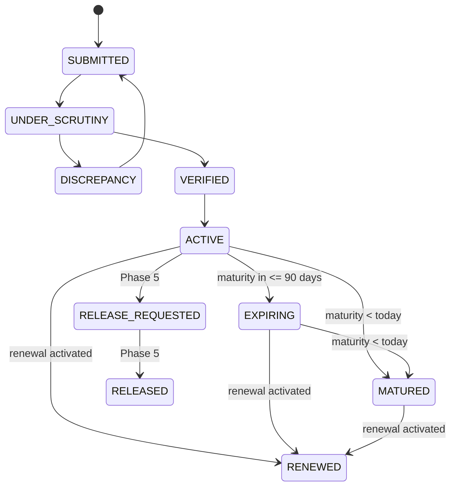
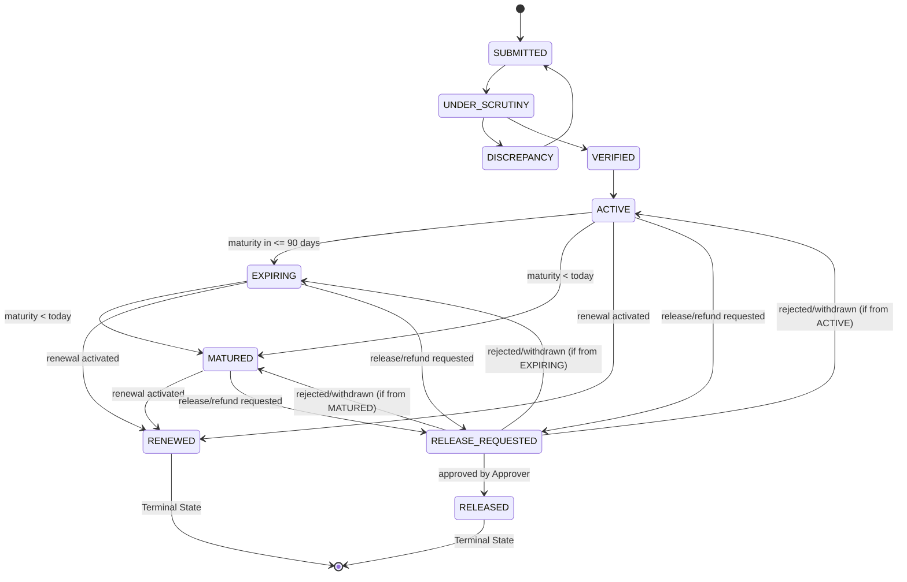
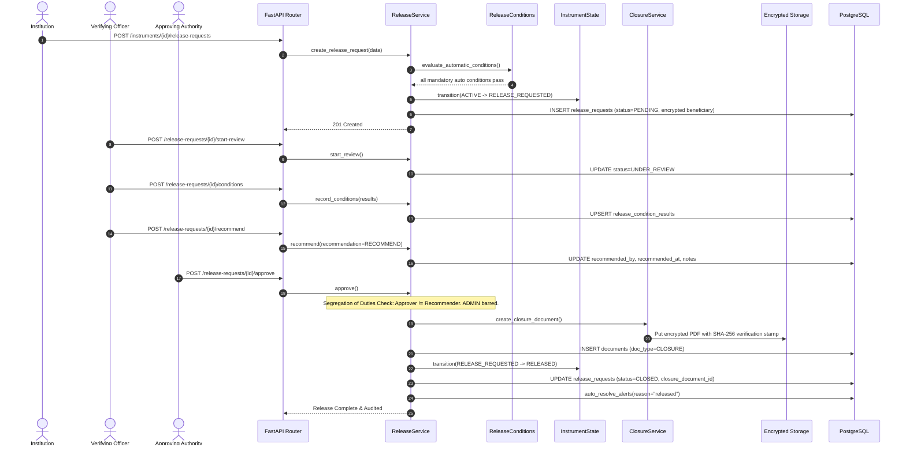

# FDR Portal — Architecture

## Component Diagram

## Two-Step Authentication Flow (JWT + OTP)

## Document Encryption & Storage Flow (AES-256-GCM)

## Officer Scrutiny & Mock Bank Verification Flow

## Tamper-Evident Hash Chain Architecture

## FDR Status State Machine

## ER Diagram (Phase 1 + Phase 2 + Phase 3)

---

## Phase 4: Automated Tracking, Alerts, Escalation & Renewal

### 1. Clock Abstraction (`core/clock.py`)
- Standardized access to `today()` and `now()` pinned to IST (`Asia/Kolkata`).
- Supports programmatic overriding via `set_test_override()` and environment-driven calendar shifting via `CLOCK_OVERRIDE_DATE` when `DEMO_MODE=true`.
- Enforces strict isolation: service and worker code is forbidden from calling `date.today()` or `datetime.now()` directly.

### 2. Automated Validity & Maturity Scanner (`services/monitoring.py`)
- Executed on a daily beat schedule at 02:00 IST via Celery or manually triggered by Admin via `POST /admin/jobs/run-daily-scan`.
- Deterministic and strictly idempotent:
  - Detects `ACTIVE` instruments approaching maturity within the largest reminder window (default 90 days) and transitions them to `EXPIRING`.
  - Detects `ACTIVE` or `EXPIRING` instruments past their maturity date and transitions them to `MATURED`.
  - Evaluates configured `AlertRule` records and inserts pending alerts using a multi-column uniqueness constraint (`instrument_id`, `rule_id`, `recipient_user_id`, `channel`, `scheduled_for`, `escalation_level`), preventing duplicate alerts on repeated runs.
  - Automatically posts corresponding in-app `Notification` records for recipient users.

### 3. State Machine Extensions

### 4. Alert Dispatch & Multi-Channel Delivery (`services/alert_sender.py`)
- Dispatcher periodic task runs every 5 minutes batching `PENDING` alerts.
- **Email Delivery**: Formatted HTML and plain-text emails delivered to MailHog (port 1025) or configured SMTP server.
- **SMS Delivery**: Console and Twilio providers. Reference numbers are automatically masked (all but last 4 characters replaced with `*`).
- **In-App Inbox**: Dedicated user inbox accessible via `/notifications` with read-state tracking.
- **Fault Tolerance**: Automatic retry with exponential backoff (`ALERT_RETRY_BASE_SECONDS * 2^retries`). Alerts reaching 5 failures transition to `FAILED` without blocking sibling alerts.

### 5. Multi-Level Escalation Engine (`services/escalation.py`)
- Unacknowledged alerts exceeding `rule.escalate_after_days` automatically trigger escalation:
  - **Level 0 (Institution)**: Sent to institution registrar/admins.
  - **Level 1 (Verifying Officer)**: Created after grace period expires with `parent_alert_id` link.
  - **Level 2 (Approving Authority)**: Critical escalation when Officer alert remains unacknowledged.
- Calling `POST /alerts/{id}/acknowledge` records timestamp and user, immediately stopping further escalation.
- Resolving an instrument (e.g. renewal completion or activation) invokes `auto_resolve_alerts()` which marks all linked open alerts resolved in the same transaction.

### 6. Renewal & Lineage Tracking (`services/renewal_service.py`)
- **Initiation**: `POST /instruments/{id}/renew` validates status (`ACTIVE`, `EXPIRING`, `MATURED`), verifies no duplicate in-flight renewals, and spawns a new instrument stub (`status=SUBMITTED`, `replaces_instrument_id=old.id`).
- **Atomic Completion**: Upon scrutiny verification and Approver activation (`POST /instruments/{new_id}/activate`), the transaction atomically:
  1. Transitions new instrument to `ACTIVE`.
  2. Transitions old instrument to `RENEWED`.
  3. Creates `RenewalLink` with `renewed_after_maturity` flag (capturing if old instrument was already expired).
  4. Auto-resolves all pending alerts on the old instrument.
- **Lineage Tree**: `GET /instruments/{id}/lineage` recursively traverses `replaces_instrument_id` ancestors and `replaced_by` descendants, providing full audit visibility of the renewal chain.

---

## Phase 5: Release & Refund Workflow, Dashboard Analytics, and Reporting Engine

### 1. Final State Machine

### 2. Multi-Level Release & Approval Sequence

### 3. Shared Filter Layer (`services/instrument_filters.py`)
- Provides a centralized `InstrumentFilter` model (`extra="forbid"`) and `build_query()` generator.
- All query parameters use parameterized SQLAlchemy expressions with whitelisted columns and comparison operators, preventing SQL injection.
- **Tenant Isolation**: `scope_to_institution(query, user, Instrument)` is unconditionally applied as the final filter barrier. An institution user can never widen their query scope.
- Reusable `missing_documents(instrument)` helper evaluates required uploads across filters, queue management, and dashboards.

### 4. High-Performance Dashboard Analytics & Redis Caching
- **Raw SQL Aggregation**: Metrics are computed in single-query aggregates with `group_by` and conditional `sum`/`count`, avoiding N+1 roundtrips.
- **Cache-Aside Architecture**: Cached with Redis TTL (default 60s). Cache keys strictly isolate tenant and role:
  `dashboard:{endpoint}:{role}:{institution_id or 'all'}:{param_hash}`
- **Failover Guarantee**: Gracefully falls back to real-time database queries if Redis is unavailable.

### 5. Multi-Format Reporting Engine (`services/reports/`)
- Unified `ReportRegistry` managing 8 specialized reports: `pending-verifications`, `upcoming-maturities`, `missing-documents`, `cases-needing-intervention`, `release-pipeline`, `institution-statement`, `renewal-history`, and `my-instruments`.
- **Injection Sanitization**: All cells starting with `=`, `+`, `-`, or `@` are sanitized with leading apostrophes to protect downstream spreadsheet applications.
- **Styling**: OpenPyXL workbooks styled with official AICTE palette (`#1B365D`), frozen header panes, and dedicated audit metadata sheets.
- **Streaming & Truncation**: Streaming response capped at 50,000 rows with `X-Report-Truncated` notification headers.
- **Auditability**: Every export event writes a hash-chained audit record.

---

## Phase CR: Multi-Instrument & Central Document Registry

### 1. Instrument Types (`FDR` & `BANK_GUARANTEE`)
The portal models both Fixed Deposit Receipts and Bank Guarantees with shared lifecycle transitions and type-specific constraints:
- **Bank Guarantee Core Fields**:
  - `claim_expiry_date`: Mandated claim lodgement deadline, constrained at database level to be $\ge \text{maturity\_date}$ (`ck_instrument_bg_claim_expiry`). Recommended $\ge 30$ days beyond maturity.
  - `beneficiary_name`: Beneficiary organization, defaults to `"AICTE"`.
  - `reference_number`: Serves as the Guarantee Reference Number.

### 2. Central Document Registry (`core/document_registry.py`)
Single source of truth for all operational documents:
- Seven registered types:
  1. `FDR_SCAN`: Original FDR Certificate (Mandatory for FDR).
  2. `BANK_GUARANTEE_DOCUMENT`: Original Bank Guarantee Document (Mandatory for BG).
  3. `DEPOSIT_CONFIRMATION`: Bank Deposit Confirmation Slip (Mandatory for FDR).
  4. `BANK_LETTER`: Bank Confirmation & Lien Letter (Mandatory for BG, optional for FDR).
  5. `RENEWAL_CERTIFICATE`: Renewal FDR / BG Extension Certificate (Mandatory on renewal).
  6. `CLOSURE`: Discharge & Release Certificate (Generated by AICTE on `RELEASED`).
  7. `OTHER`: Fallback attachment.
- Exposed via public endpoint: `GET /meta/document-types`.
- Drives UI upload slots, backend validation, missing document queries, and OCR profiles without hardcoded enums.

### 3. AI/ML Pipeline Integration
- **OCR Profiles**: Per-document-type extraction profiles for `BANK_GUARANTEE_DOCUMENT` (guarantee number, bank, amount, issue/maturity/claim dates, beneficiary) and `RENEWAL_CERTIFICATE`.
- **Cross-Document Consistency**: Type-aware cross-check:
  - For FDR: `FDR_SCAN` vs. `DEPOSIT_CONFIRMATION` vs. `BANK_LETTER`.
  - For Bank Guarantee: `BANK_GUARANTEE_DOCUMENT` vs. `BANK_LETTER`.
- **Trust Score**: Document completeness and date consistency factors dynamically adapt based on instrument type.
- **Natural Language Search**: Detects `instrument_types` ("bank guarantee", "bg", "fdr") and specific `missing_doc_types`.
